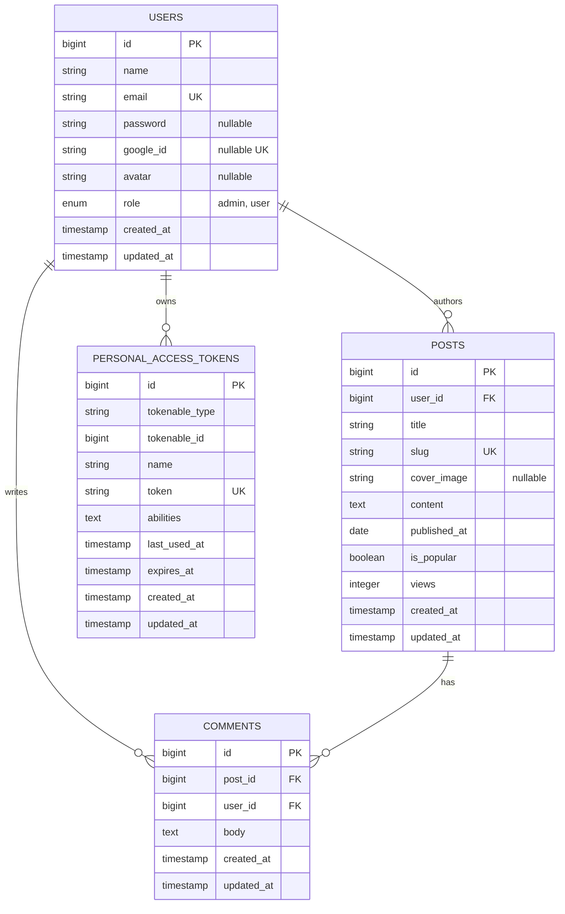

# 🗄️ ERD.md (Entity Relationship Document)

## 1. Entity Relationship Diagram (Mermaid)

## 2. Data Schema & Constraints

### 2.1 Table: `users`

* `id`: `BIGINT`, Primary Key, Auto Increment.
* `name`: `VARCHAR(255)`, NOT NULL.
* `email`: `VARCHAR(255)`, NOT NULL, Unique Index.
* `password`: `VARCHAR(255)`, Nullable (null jika registrasi via Google).
* `google_id`: `VARCHAR(255)`, Nullable, Unique Index.
* `avatar`: `VARCHAR(255)`, Nullable.
* `role`: `ENUM('admin', 'user')`, DEFAULT `'user'`.

### 2.2 Table: `posts`

* `id`: `BIGINT`, Primary Key, Auto Increment.
* `user_id`: `BIGINT`, Foreign Key referencing `users(id)` ON DELETE CASCADE.
* `title`: `VARCHAR(255)`, NOT NULL.
* `slug`: `VARCHAR(255)`, NOT NULL, Unique Index.
* `cover_image`: `VARCHAR(255)`, Nullable (menyimpan relative path, misal: `posts/cover_xyz.jpg`).
* `content`: `LONGTEXT`, NOT NULL.
* `published_at`: `DATE`, NOT NULL.
* `is_popular`: `BOOLEAN`, DEFAULT `false`.
* `views`: `INTEGER`, DEFAULT `0`.

### 2.3 Table: `comments`

* `id`: `BIGINT`, Primary Key, Auto Increment.
* `post_id`: `BIGINT`, Foreign Key referencing `posts(id)` ON DELETE CASCADE.
* `user_id`: `BIGINT`, Foreign Key referencing `users(id)` ON DELETE CASCADE.
* `body`: `TEXT`, NOT NULL.
